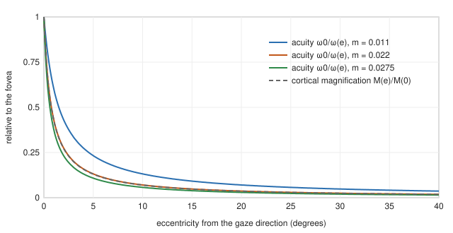
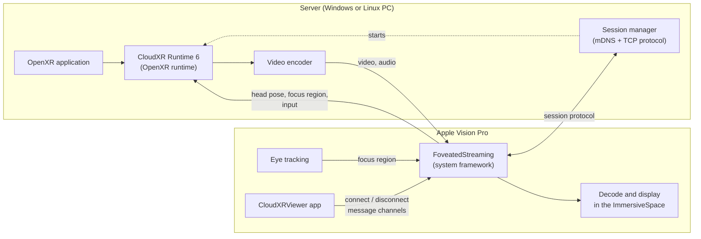
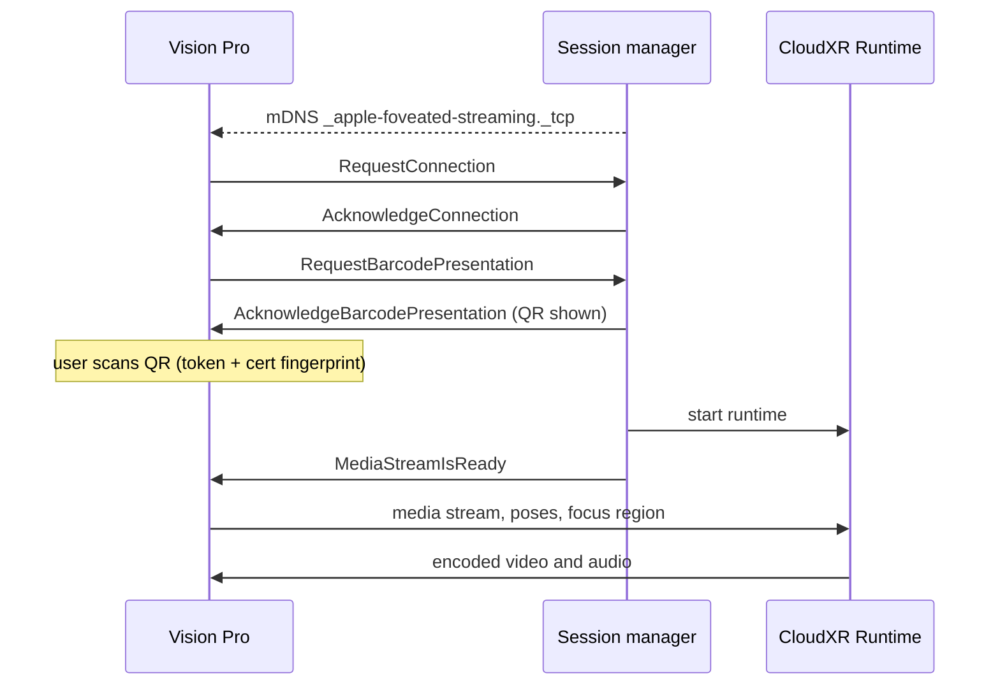
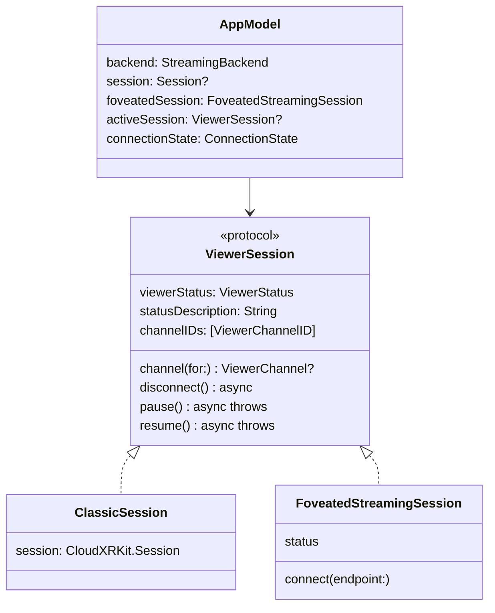

# Foveated streaming: theory and code

This fork of NVIDIA's CloudXR Generic Viewer streams an OpenXR application from a server to Apple Vision Pro (and to iPhone and iPad) in two ways. The **CloudXR** backend uses the CloudXRKit Swift package, as the upstream viewer does. The **Foveated Streaming** backend uses Apple's FoveatedStreaming system framework: the headset tells the server, roughly, where the user is looking, and the server spends its video bits there. On iOS the second backend is Apple's StreamingSession package, which has the same API but no eye tracking.

This document explains why foveation works (the visual system), what kinds of foveation exist and which one this app uses, what limits it in time (eye movements and latency), how the whole pipeline is wired from the OpenXR application to the headset, and what the system does with the user's gaze. Each topic then points to the code in this repository. The companion book in [`../LiterateP`](../LiterateP) walks through the code line by line. This document is about the ideas and how they fit together.

The code links point to the Swift sources under [`../CloudXRViewer`](../CloudXRViewer). Paths are relative to this `Docs/` folder.

**Contents**

1. [Why foveation works](#1-why-foveation-works)
2. [Kinds of foveation](#2-kinds-of-foveation)
3. [Time: eye movements and latency](#3-time-eye-movements-and-latency)
4. [The streaming pipeline](#4-the-streaming-pipeline)
5. [Privacy: where the gaze goes](#5-privacy-where-the-gaze-goes)
6. [Application architecture](#6-application-architecture)
7. [Experiments: comparing the backends](#7-experiments-comparing-the-backends)
8. [Limitations](#8-limitations)
9. [References](#9-references)

---

## 1. Why foveation works

### 1.1 Fovea, parafovea, periphery

The retina does not sample the visual field uniformly. Cone photoreceptors are packed most densely in the **fovea**, a pit roughly 5° across. Its center, the **foveola** (about 1° to 1.5° across), has no rods and the finest cone spacing. Around it, the **parafovea** and **perifovea** extend to roughly 8° to 10° of eccentricity, and beyond that lies the **periphery**. Ganglion cells, which pool cone signals before they leave the eye, become sparser and pool over larger areas with eccentricity, faster than the cones themselves thin out. (All angles here are approximate textbook values [5, 6].)

The consequence is that **visual acuity**, the finest detail one can resolve, is highest along the line of sight and falls steeply away from it. A common way to describe it is the **minimum angle of resolution** (MAR) $\omega$, the smallest resolvable feature in degrees. Guenter et al. [1] used a linear model,

$$\omega(e) = m\,e + \omega_0,$$

where $e$ is the eccentricity in degrees, $\omega_0$ is the foveal MAR (about 1 arcminute, $1/60°$, for normal vision) and $m$ is the slope. From a user study they fitted $m$ between 1.32 and 1.65 arcminutes per degree, that is $m \approx 0.022$ to $0.0275$. Relative acuity is $\omega_0 / \omega(e)$: with $m = 0.022$ it is 43% at 1°, 13% at 5° and 7% at 10° (figure 1).

*Figure 1. Relative acuity of the linear MAR model for three slopes (solid), and cortical magnification normalized at the fovea (dashed). Generated by figures/make_figures.py.*

### 1.2 Cortical magnification

The same falloff appears in the brain. The primary visual cortex devotes far more tissue to the center of the visual field than to the periphery. The **cortical magnification factor** $M(e)$, millimeters of cortex per degree of visual field, was estimated by Horton and Hoyt [7] as

$$M(e) = \frac{17.3}{e + 0.75}\ \text{mm/deg}.$$

It falls to half its foveal value at $e = 0.75°$ and to about 7% at 10° (dashed curve in figure 1). Roughly, a fixed area of cortex processes a smaller and smaller part of the image as one moves away from the gaze, so detail rendered there is never seen.

### 1.3 Why it saves pixels and bits

Suppose an image covers a disc of radius $r$ degrees around the gaze. A uniform image with a sample every $\omega_0$ needs about $\pi r^2 / \omega_0^2$ samples. An ideally foveated image needs a sample only every $\omega(e)$ at eccentricity $e$, so its count is

$$N_\text{fov} \propto \int_0^r \frac{2\pi e}{\omega(e)^2}\,de .$$

Figure 2 plots the ratio $N_\text{fov} / N_\text{uniform}$. Under this idealized model, a 20° disc needs under 1% of the uniform sample count, and the ratio keeps dropping as the field grows. Guenter et al. extrapolated a speedup of about 100× for a 70° field at foveal resolution [1].

*Figure 2. Samples needed by an ideal foveated image as a fraction of a uniform one, against the radius of the field. Solid: uniform density of 60 samples/degree (foveal acuity). Dashed: a display limited to 30 samples/degree, which is illustrative. Generated by figures/make_figures.py.*

Real savings are much smaller than the curve suggests, for four reasons:

* **Displays are below foveal acuity.** Current headsets show fewer than 60 pixels per degree, so the uniform baseline is the display's resolution, not the eye's. The dashed curve caps the density at 30 samples per degree (an illustrative value, not a Vision Pro specification) and roughly quadruples the ratio.
* **The gaze estimate is uncertain.** Eye trackers have errors of a degree or so, and the gaze moves (§3), so the full-quality region must be larger than the fovea.
* **Peripheral vision is not blind.** It is sensitive to motion, flicker and contrast, so aggressive reduction causes visible artifacts: shimmering aliasing, a "tunnel vision" feeling, popping at region boundaries [2].
* **Measured systems are conservative.** Guenter et al. measured a 5 to 6× speedup on a 1920×1080 desktop display [1], an order of magnitude below their extrapolation.

For streaming, the saving that matters is **bits**, not pixels. A video encoder spends most of its bit rate on detail and on motion. If the periphery is encoded coarsely, the stream needs fewer bits for the same perceived quality, or it can raise the foveal quality at the same bit rate. That is what this app's Foveated Streaming backend does (§2.3).

### Code

This section has no code in the app, which never models acuity itself. The figures are produced by [`figures/make_figures.py`](figures/make_figures.py), which implements exactly the formulas above (`mar`, `relative_acuity`, `cortical_magnification`, `sample_fraction`) and prints the values quoted in the text.

---

## 2. Kinds of foveation

### 2.1 Fixed foveated rendering

**Fixed foveation** assumes the user looks straight ahead through the lens center. It renders the center of each eye's image at full resolution and the edges at lower resolution, often with variable-rate shading or multi-resolution viewports. It needs no eye tracker. It works because head-mounted displays are blurrier at the edges of their lenses anyway, and users tend to turn their heads toward what interests them. Its saving is modest, because the full-quality region must cover everywhere the eyes may plausibly look.

### 2.2 Dynamic (eye-tracked) foveated rendering

**Dynamic foveation** moves the full-quality region with the measured gaze, so it can be much smaller. Guenter et al. rendered three nested layers of decreasing resolution centered on the gaze and blended them [1]. Patney et al. showed that simply lowering peripheral resolution causes a sense of tunnel vision, and that preserving peripheral *contrast* and suppressing temporal aliasing lets the periphery be reduced much further without users noticing [2]. Apple Vision Pro uses dynamic foveated rendering locally, for apps that render on the device.

### 2.3 Foveated encoding and streaming

When the image is rendered on a remote server, there are two separate places to foveate:

1. **Rendering**, on the server: render the periphery with fewer samples. This is the OpenXR application's business.
2. **Encoding**, between the server and the headset: compress the periphery harder. This is the streaming system's business.

Foveated **encoding** works on any rendered frame. Block-based codecs (H.264, HEVC, AV1) choose a quantization parameter (QP) per block. A larger QP means a coarser quantizer step, fewer bits and less detail. In H.264 and HEVC the step size doubles every 6 QP units, so a few units of QP make a large difference in bit rate. A **QP map** or **region-of-interest map** assigns lower QP (more bits) to blocks near the gaze and higher QP far from it. NVIDIA's NVENC encoders, for example, accept per-macroblock QP delta or "emphasis" maps. The gaze region must reach the encoder every frame, and it must be predicted far enough ahead to cover the network delay (§3).

The Foveated Streaming backend of this app uses **dynamic foveated streaming**: visionOS shares the approximate focus region with the CloudXR Runtime, which uses it "only to optimize encoding quality" [8]. NVIDIA does not document the exact encoder mechanism, so this document does not claim it is a particular QP-map scheme. The CloudXR backend has no gaze input, so its stream has the same quality everywhere (apart from any fixed foveation the server application does on its own).

| | Fixed rendering | Dynamic rendering | Dynamic encoding (this app) |
|---|---|---|---|
| Needs eye tracking | no | yes | yes |
| Where it runs | renderer | renderer | streaming runtime and encoder |
| Saves | GPU time | GPU time | network bit rate |
| Works with any OpenXR app | yes | only if the app implements it | yes |
| Gaze visible to the app | n/a | yes | no (§5) |

### Code

* [`StreamingBackend`](../CloudXRViewer/Common/Streaming/ViewerSession.swift) names the two choices: `.classic` (no foveation) and `.foveated` (dynamic foveated streaming on visionOS, plain StreamingSession on iOS). Its `label` shows "Foveated Streaming" on visionOS and "Streaming Session" on iOS, because iOS devices have no eye tracker.
* The foveation itself is entirely inside the system framework and the CloudXR Runtime. The app's role is to create the session, connect it and present the scene that shows the stream (§6). [`FoveatedStatusView`](../CloudXRViewer/visionOS/WindowUI.swift) explains this to the user in the HUD tab.

---

## 3. Time: eye movements and latency

### 3.1 How the eyes move

The eyes are rarely still. Between **fixations**, which last roughly 200 to 300 ms when looking at a scene, they jump in **saccades**. A saccade lasts about 20 to 100 ms depending on its size, and its peak angular velocity can reach several hundred degrees per second. Slow **smooth pursuit** tracks moving objects, and small drifts and microsaccades continue even during fixation. (All values approximate [5].)

During a saccade and for some tens of milliseconds around it, sensitivity to visual change is strongly reduced (**saccadic suppression**). The eye cannot resolve detail while it moves fast, and the brain partly discounts the smeared image. This helps foveated systems: if the high-quality region arrives at the new fixation point a little late, the user may not notice, because they were partly "blind" during the jump.

### 3.2 The latency budget

The **gaze-to-photon latency** of a foveated system is the time from an eye movement until the display shows a frame whose high-quality region follows that movement. For a streamed system it is the sum of:

1. eye-tracker exposure and processing on the headset;
2. sending the gaze to the server (half a network round trip);
3. waiting for the next frame and encoding it with the new focus region;
4. sending the frame back (the other half of the round trip), decoding and displaying it.

Albert et al. measured how much foveation users accept as eye-tracking latency grows. With 20 to 40 ms of added eye-tracking latency, acceptance did not drop noticeably; with 80 to 150 ms it dropped significantly. They concluded that a total system latency of about 50 to 70 ms can be tolerated [3]. A streaming system with a network round trip in the tens of milliseconds therefore sits near this limit.

### 3.3 Margins

The usual answers to latency and tracking error are:

* **Margins.** Make the full-quality region larger than the fovea by the expected gaze error plus how far the gaze can travel in one latency period. This trades bits for robustness.
* **Prediction.** Predict where a saccade will land from its initial velocity, and send the region for the predicted point.
* **Graceful periphery.** Make the periphery look acceptable even when it briefly lands under the gaze: avoid flicker, keep contrast, avoid sharp quality boundaries [2].

### Code

The app does not see the gaze, so it implements none of these strategies; the runtime and the system do. What the app controls is the network path, through the endpoint it connects to (§4, §6.4). For the lowest latency it should use a local server on a dedicated Wi-Fi network, as the README's "Network Reachability" section recommends. The [`com.apple.developer.low-latency-streaming`](../CloudXRViewer/visionOS/CloudXRViewer-visionOS.entitlements) entitlement, which both backends use, lets the system prioritize the streaming traffic.

---

## 4. The streaming pipeline

### 4.1 The parts

* The **OpenXR application** renders stereo frames as it would for any headset. It talks only to the OpenXR API.
* The **CloudXR Runtime** is the OpenXR runtime on the server. Instead of a local headset it has a network client: it receives head poses and input from the device, hands them to the application, encodes the frames and streams them back. With Foveated Streaming it also receives the focus region.
* The **session manager** is a separate server process that implements Apple's session-management protocol (§4.2). Apple's sample is `StreamingSession-WindowsApp` in the `apple/streamingsession` repository [9]; NVIDIA's server setup guide describes the same four steps [8].
* On the headset, the **FoveatedStreaming** framework does the whole client side: discovery, pairing, the CloudXR connection, decoding, display and foveation. The **app** creates the session, chooses the endpoint, presents the immersive space and uses the opaque message channels.

### 4.2 Discovery, pairing and session setup

For a local server, the protocol runs as follows, as implemented by Apple's Windows sample [9]:

1. **Advertisement.** The session manager advertises an mDNS (Bonjour) service of type `_apple-foveated-streaming._tcp`. Its TXT record carries the bundle identifier of the client app, so a headset can tell which server belongs to which app.
2. **Connection.** The headset opens a TCP connection to the advertised port. Messages are JSON objects, each preceded by a 4-byte little-endian length. Every message has an `Event` field: `RequestConnection`, `AcknowledgeConnection`, `RequestBarcodePresentation`, `AcknowledgeBarcodePresentation`, `SessionStatusDidChange`, `MediaStreamIsReady`, `RequestSessionDisconnect`.
3. **Pairing.** When the headset sends `RequestBarcodePresentation`, the server shows a QR code. It holds a client token and the fingerprint of the server's certificate, both generated by the CloudXR Runtime. The user looks at the QR code; the headset reads it and can then authenticate the server it is talking to.
4. **Streaming.** The session manager starts the CloudXR Runtime and sends `MediaStreamIsReady`. The headset connects the media stream, and the immersive space appears.

For a cloud server, the `.remote` endpoint replaces discovery and QR pairing with a server name and signaling headers.

### Code

* **Endpoints.** [`FoveatedEndpointKind`](../CloudXRViewer/Common/Streaming/FoveatedSession.swift) has three cases that map to the framework's `FoveatedStreamingSession.Endpoint`: `.discover` → `.systemDiscovered` (steps 1 to 3 above, with the system's own server list and QR scanner), `.local` → `.local(ipAddress:port:)` with `Network`'s `IPv4Address`/`IPv6Address` and `NWEndpoint.Port`, and `.remote` → `.remote(serverName:signalingHeaders:)`. `endpoint(hostAddress:port:serverName:)` validates the user's input and throws a readable error. `defaultPort` is 55000, the port of NVIDIA's examples.
* **Bonjour.** Both Info.plists ([visionOS](../CloudXRViewer/visionOS/CloudXRViewer-visionOS-Info.plist), [iOS](../CloudXRViewer/iOS/CloudXRViewer-iOS-Info.plist)) declare `_apple-foveated-streaming._tcp` in `NSBonjourServices`, which iOS requires before an app may browse for a service type.
* **Pairing on iOS.** [`LaunchView+iOS.swift`](../CloudXRViewer/iOS/LaunchView+iOS.swift) attaches the StreamingSession modifiers `.deviceDiscovery(session:)` and `.devicePairing(session:)`, which present the system's server list and QR scanner. On visionOS the framework presents them itself.
* **Connecting.** `doConnectFoveated()` in [`SessionConfigView.swift`](../CloudXRViewer/Common/SessionConfigView.swift) builds the endpoint, sets the presentation behaviors (§6.3), requests hand tracking on visionOS 27 if enabled, and calls `try await session.connect(endpoint:)`. Errors thrown before the session reports a status go to `AppModel.foveatedConnectError` and appear under the form.

---

## 5. Privacy: where the gaze goes

Where a person looks reveals a lot: what they read, what attracts them, sometimes health conditions. visionOS therefore never gives apps raw gaze data; even hover effects are drawn by the system outside the app's process.

Foveated Streaming keeps that rule. NVIDIA's documentation states that the CloudXR Runtime does not expose the user's focus region to the OpenXR application, and uses it only to optimize encoding quality [8]. Apple describes the mode as dynamically foveated streaming that preserves privacy [10]. So the chain is:

* the **eye tracker** and **visionOS** compute an approximate focus region;
* the **FoveatedStreaming framework** sends it to the **CloudXR Runtime**, inside the encrypted streaming session;
* the **runtime** uses it for encoding;
* neither the **client app** (this viewer) nor the **OpenXR application** ever receives it.

In the framework's interface, a focus region appears only as `FoveatedStreamingProviderFocusRegion` (a direction, a distance and a timestamp), which belongs to the API for system *streaming-provider extensions* (visionOS 27), not to `FoveatedStreamingSession`. The session API that this app uses has no way to read the gaze.

### Code

* The app-facing API has nothing to do with gaze: [`ViewerSession`](../CloudXRViewer/Common/Streaming/ViewerSession.swift) exposes status, message channels, disconnect, pause and resume, and nothing else is needed.
* The [`com.apple.developer.foveated-streaming-session`](../CloudXRViewer/visionOS/CloudXRViewer-visionOS.entitlements) entitlement grants the app the right to start such a session. Apple grants it to members of the Apple Developer Program, like the low-latency-streaming entitlement.
* Hand tracking is different: it *is* sent to the server, and needs the user's permission. `doConnectFoveated()` calls `requestAuthorization(for: [.handTracking])` and sets `requestedInputCapabilities` only when the user turned on **Enable Hand Tracking** (visionOS 27 and later).

---

## 6. Application architecture

### 6.1 Two backends behind one protocol

The upstream viewer used CloudXRKit's `Session` everywhere: in the window manager, the config form, the data-channel view and the app's scene code. The fork introduces one protocol and two adapters so that all of that code works with either backend.

* [`ViewerSession.swift`](../CloudXRViewer/Common/Streaming/ViewerSession.swift) defines `StreamingBackend`, `ViewerStatus` (one status enum for both SDKs: `initialized`, `connecting`, `connected`, `pausing`, `paused`, `resuming`, `disconnecting`, `disconnected(error:)`), `ViewerChannelID`, `ViewerChannel` and the `@MainActor` protocol `ViewerSession`.
* [`ClassicSession`](../CloudXRViewer/Common/Streaming/ClassicSession.swift) wraps a CloudXRKit `Session`. It keeps no state: every property reads through, so SwiftUI's observation of `Session.state` still works through the adapter. It folds CloudXRKit's `authenticating`/`authenticated` into `connecting`. An extension makes `CloudXRKit.MessageChannel` a `ViewerChannel`, turning `sendServerMessage`'s `Bool` into a thrown error.
* [`FoveatedSession.swift`](../CloudXRViewer/Common/Streaming/FoveatedSession.swift) makes `FoveatedStreamingSession` itself conform to `ViewerSession`. Its own `disconnect()`, `pause()` and `resume()` already have the right signatures; the extension adds the status mapping and channel listing. `appInitiatedDisconnect` maps to a clean disconnection, every other reason to an error message.
* [`AppModel`](../CloudXRViewer/Common/AppModel.swift) owns the persisted `backend`, the CloudXRKit `session` (still needed directly by `CloudXRSessionComponent` and the HUD), one `foveatedSession` for the app's lifetime, and `activeSession`, which picks between them. `status` and `disconnect()` go through `activeSession`.

### 6.2 Observing status: `ConnectionState`

The scenes react to connection changes, for example to switch from the launch window to the content window on connect and to show an alert on an error. They observe `AppModel.connectionState`, a [`ConnectionState`](../CloudXRViewer/Common/Streaming/ViewerSession.swift) that pairs the status with its backend. Switching backends changes `status` too (the other session may be `disconnected` with an old error), so every observer in [`ViewerApp.swift`](../CloudXRViewer/Common/ViewerApp.swift) first checks `oldState.backend == newState.backend` and ignores changes caused by a switch.

[`WindowStateManager`](../CloudXRViewer/Common/WindowStateManager.swift) (`onConnectionStateChanged(oldState:newState:)`) receives the unified `ViewerStatus`. The manager is now `@MainActor`, like `AppModel`, which also made its old lock unnecessary.

### 6.3 Who opens the immersive space

With CloudXRKit, the app opens its `ImmersiveSpace(id: immersiveTitle)` itself, and `GenericImmersiveView` attaches a `CloudXRSessionComponent` to an entity to render the stream. Foveated Streaming inverts this:

* [`ViewerApp`](../CloudXRViewer/Common/ViewerApp.swift) declares a second scene, `ImmersiveSpace(foveatedStreaming: appModel.foveatedSession) { FoveatedImmersiveView() }`, with the progressive immersion style. The framework renders the stream into it.
* Before connecting, `doConnectFoveated()` sets `session.immersivePresentationBehaviors = .automatic(openImmersiveSpace, dismissImmersiveSpace)`. The session opens the space when streaming starts and dismisses it on disconnect.
* So `LaunchView.showImmersiveSpace()` ([`LaunchView+visionOS.swift`](../CloudXRViewer/visionOS/LaunchView+visionOS.swift)) and `WindowStateManager.handleConnectionEstablished()`/`handleDisconnection()` open and dismiss the space only for `.classic`. Resuming from pause likewise reopens it only for `.classic`.
* [`FoveatedImmersiveView`](../CloudXRViewer/visionOS/FoveatedImmersiveView.swift) contains only overlay content: the invisible gesture wall shared with `GenericImmersiveView` (`makeInvisibleGestureWall()`, now `static`) so a triple tap toggles the window, and the same lifecycle hooks as the classic space.
* When the user presses the Digital Crown, `immersiveSpaceOnDisappear()` pauses the active session through `ViewerSession.pause()`. `.foveatedStreamingPauseSheet(session:)` on the launch window shows the system's pause sheet for the foveated session; its binding is `nil` while the classic backend is selected.

On iOS, [`StreamingView+iOS.swift`](../CloudXRViewer/iOS/StreamingView+iOS.swift) shows `FoveatedStreamingView(session:)` instead of the RealityKit view with the CloudXRKit component, and hides the CloudXRKit statistics HUD.

### 6.4 The configuration form

[`SessionConfigView`](../CloudXRViewer/Common/SessionConfigView.swift) keeps the upstream classic flow untouched and branches at the start of `handleConnectButtonTap()`. The foveated flow is `handleFoveatedConnectButtonTap()` (resume when paused, ask before disconnecting when connected, otherwise connect) and `doConnectFoveated()` (§4). The forms in [`SessionConfigView+visionOS.swift`](../CloudXRViewer/visionOS/SessionConfigView+visionOS.swift) and [`SessionConfigView+iOS.swift`](../CloudXRViewer/iOS/SessionConfigView+iOS.swift) add a segmented backend picker and a `foveatedConfigSection` with the server kind, the IP address (reusing the classic `hostAddress` setting) and port, or the remote server name.

### 6.5 Message channels

[`ServerActionsView`](../CloudXRViewer/Common/ServerActionsView.swift) sends and receives opaque messages, for example to trigger actions in the OpenXR application. It now holds a `ViewerChannelID?` and an `any ViewerChannel`, lists `activeSession.channelIDs`, opens a channel with `channel(for:)` and sends with `try send(_:)`. Received messages arrive through `receivedMessageStream` in both SDKs. On visionOS 26 the framework's channel IDs have no public text form, so the label falls back to `String(describing:)`; from visionOS 27 it uses `stringRepresentation`.

### 6.6 Device-only frameworks: `FOVEATED_STREAMING`

FoveatedStreaming exists only in the device SDK of visionOS, and the StreamingSession package ships only a device slice for iOS. [`Config.xcconfig`](../Config.xcconfig) therefore sets the Swift compilation condition `FOVEATED_STREAMING` for the `xros` and `iphoneos` SDKs only. Every import of the two frameworks and every use of their types is inside `#if FOVEATED_STREAMING`, and `StreamingBackend.available` is just `[.classic]` without it, so the visionOS Simulator still builds and runs the classic backend, as upstream did. The iOS target cannot build for the simulator at all, because the package's binary has no simulator slice; upstream's iOS path needed ARKit on a device anyway.

### 6.7 Project settings

| Setting | Value | Why |
|---|---|---|
| visionOS deployment target | 26.4 | first release with FoveatedStreaming |
| iOS deployment target | 27.0 | required by the StreamingSession package |
| Packages | `cloudxr-framework` (both), `streamingsession` (iOS) | referenced in the project, resolved by Xcode |
| Entitlements (visionOS) | `low-latency-streaming`, `foveated-streaming-session` | §3, §5 |
| `NSBonjourServices` | `_apple-foveated-streaming._tcp` | §4.2 |

Hand tracking over Foveated Streaming and the text form of channel IDs need visionOS 27; the code checks with `#available`.

---

## 7. Experiments: comparing the backends

The point of keeping both backends is to compare the same content with and without foveation. Some experiments that need only the app and a server:

### 7.1 Bit rate at equal quality

Run the same OpenXR scene with each backend, on the same network, and record the server's outgoing bit rate (for example with the operating system's network monitor, or the CloudXR Runtime's logs). Look at a detailed, static scene and at a scene with a lot of motion. Expectation from §1.3: at the same perceived foveal quality, the foveated stream should need fewer bits, and the difference should grow with the field of view and the amount of peripheral detail.

### 7.2 Peripheral quality

Place fine text or a high-frequency texture at the side of the scene. With the classic backend it is equally sharp everywhere. With Foveated Streaming, look straight ahead and judge the periphery; then look at it directly. If the system works, you should not be able to catch the low-quality region, because it moves with your gaze. Turning the head (instead of the eyes) to the target is a useful control.

### 7.3 Latency and saccades

Make large, fast eye movements between two detailed targets and watch whether you notice a blurry moment on landing. Repeat on a congested network (another device streaming video on the same Wi-Fi). Per §3.2, added network latency should make the delay more noticeable for the foveated backend, while the classic backend's quality does not depend on gaze at all.

### 7.4 Bandwidth stress

Limit the bandwidth (a router's quality-of-service settings or a network link conditioner on the server) and compare how each backend degrades. A foveated stream can concentrate its reduced budget on the fovea, so its foveal quality should hold up better.

Record observations in a table with the network conditions, the scene, the backend and the measured bit rate, as in this template:

| Scene | Network | Backend | Bit rate (Mbps) | Foveal quality | Peripheral artifacts |
|---|---|---|---|---|---|
| static detail | dedicated Wi-Fi | CloudXR | | | |
| static detail | dedicated Wi-Fi | Foveated Streaming | | | |

---

## 8. Limitations

* **No statistics API.** CloudXRKit exposes live latency, jitter, bandwidth and a session-quality estimate, which the app shows in its HUD and network ornament. `FoveatedStreamingSession` exposes none of these, so the foveated HUD shows only the status, and the experiments in §7 must measure on the server or the network.
* **Device only.** FoveatedStreaming and StreamingSession do not run in the simulators. Everything foveated has to be tested on an Apple Vision Pro (or an iPhone or iPad for StreamingSession) with a real server.
* **No eye tracking on iOS.** The iOS "Streaming Session" backend has the same API but no foveation.
* **Black box foveation.** The app cannot choose the size of the high-quality region, the falloff or the encoder settings; the system and the CloudXR Runtime decide. That is also what protects the user's gaze (§5).
* **Server requirements.** The foveated backend needs CloudXR Runtime 6 or later and a session manager that implements Apple's protocol. A server that works with the classic backend does not automatically work with Foveated Streaming.
* **Entitlements.** Both streaming entitlements require the Apple Developer Program.
* **Untested here.** At the time of writing the foveated path was built and checked for compile errors and UI layout, but not run against a server on a device.

---

## 9. References

1. B. Guenter, M. Finch, S. Drucker, D. Tan and J. Snyder. "Foveated 3D Graphics." *ACM Transactions on Graphics* 31(6), *SIGGRAPH Asia* 2012.
2. A. Patney, M. Salvi, J. Kim, A. Kaplanyan, C. Wyman, N. Benty, D. Luebke and A. Lefohn. "Towards Foveated Rendering for Gaze-Tracked Virtual Reality." *ACM Transactions on Graphics* 35(6), *SIGGRAPH Asia* 2016.
3. R. Albert, A. Patney, D. Luebke and J. Kim. "Latency Requirements for Foveated Rendering in Virtual Reality." *ACM Transactions on Applied Perception* 14(4), 2017.
4. M. Weier et al. "Perception-driven Accelerated Rendering." *Computer Graphics Forum* 36(2), Eurographics State of the Art Reports, 2017.
5. B. A. Wandell. *Foundations of Vision.* Sinauer, 1995. (Retina, acuity and eye movements.)
6. C. A. Curcio, K. R. Sloan, R. E. Kalina and A. E. Hendrickson. "Human Photoreceptor Topography." *Journal of Comparative Neurology* 292(4):497–523, 1990.
7. J. C. Horton and W. F. Hoyt. "The Representation of the Visual Field in Human Striate Cortex." *Archives of Ophthalmology* 109(6):816–824, 1991.
8. NVIDIA. *CloudXR SDK documentation: Foveated Streaming Framework*, *CloudXR Client for visionOS Using Foveated Streaming* and *Migration from CloudXR Framework*. https://docs.nvidia.com/cloudxr-sdk/latest/usr_guide/foveated_streaming/
9. Apple. *streamingsession* (StreamingSession-WindowsApp, StreamingSession-OpenXRSample, StreamingSession.xcframework). https://github.com/apple/streamingsession
10. Apple. *Use foveated streaming to bring immersive content to visionOS.* WWDC26 session 286. https://developer.apple.com/videos/play/wwdc2026/286/
11. Apple. *Foveated Streaming* framework documentation, including *Establishing foveated streaming sessions with Apple Vision Pro*. https://developer.apple.com/documentation/foveatedstreaming
12. ITU-T Recommendation H.265, *High efficiency video coding* (quantization parameter and step size).
